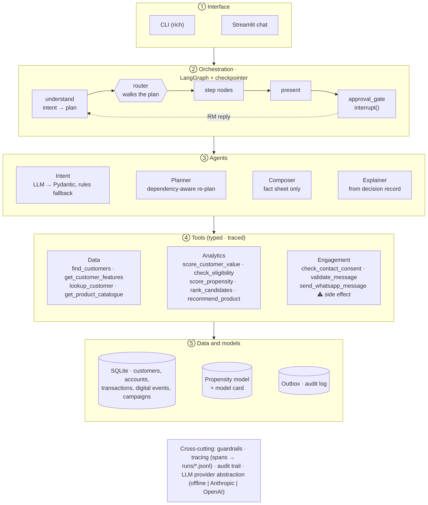
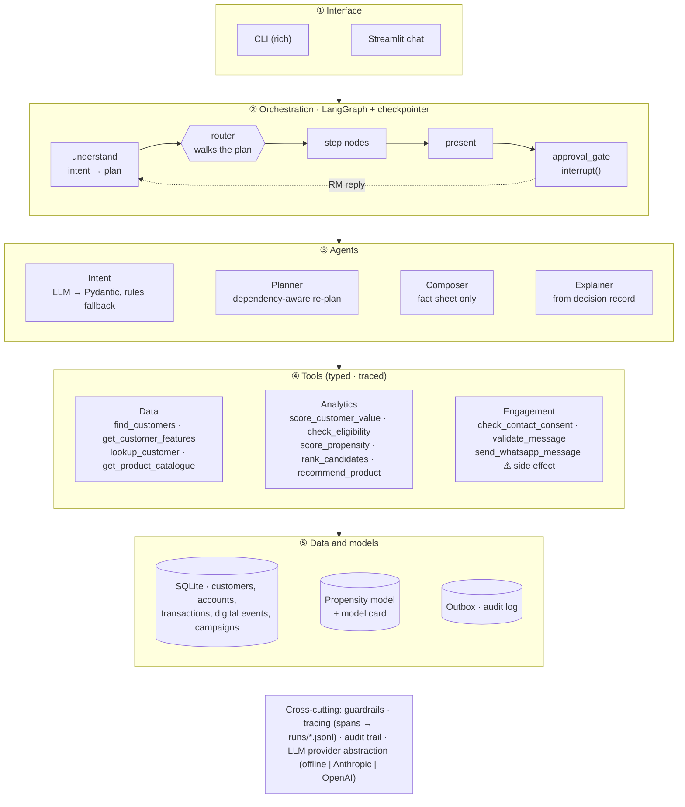
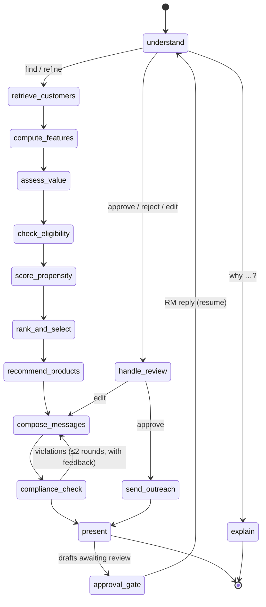
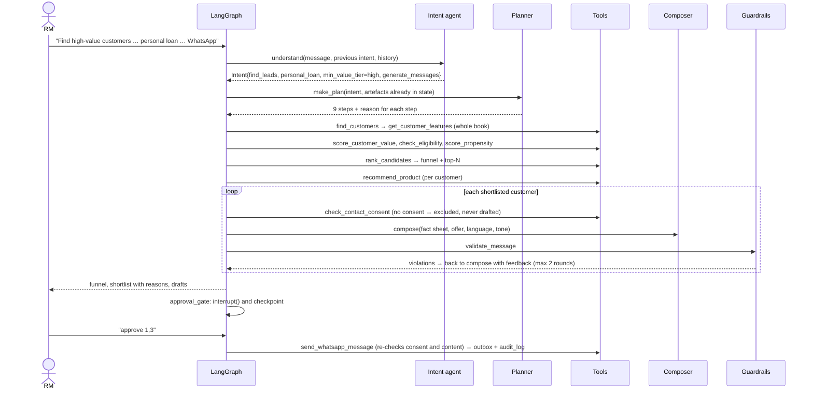

# RM Copilot: conversational agentic AI for banking CRM

An agent that helps a bank **Relationship Manager (RM)** answer:

> *"Find high-value customers likely to convert for a personal loan this month and generate personalised WhatsApp messages."*

It retrieves customer and transaction data and finds the high-value customers. It applies credit policy, estimates how likely each customer is to convert, and recommends and sizes a product. It then drafts personalised WhatsApp messages and checks every one against compliance rules. **Nothing is sent until the RM approves it.** Everything happens in one ongoing conversation: the RM can narrow the list, ask *"why this customer?"*, edit drafts and approve them without starting over.

```
RM> Find high-value customers likely to convert for a personal loan this month and generate personalised WhatsApp messages.

Funnel: 1200 in scope → 362 high-value → 193 credit-eligible → 108 likely to convert → 10 shortlisted
Drafts: 8 ready for your approval, 0 blocked by compliance · 2 not contacted (no WhatsApp consent)
Steps run: retrieve_customers → compute_features → assess_value → check_eligibility → score_propensity
           → rank_and_select → recommend_products → compose_messages → compliance_check

RM> Only salaried customers in Mumbai, top 5, in Hindi
Steps run: retrieve_customers → rank_and_select → recommend_products → compose_messages → compliance_check
           (features, value and propensity were reused from the previous turn)
```

---

## Quick start (no API key needed)

```bash
python -m venv .venv && source .venv/bin/activate
make setup          # pip install -e ".[llm,ui,dev]"
make train          # generate the synthetic bank (1,200 customers, ~43k transactions) and train the model
make chat           # conversational CLI      (or: make ui  -> Streamlit chat)
make demo           # scripted walkthrough of 5 use cases
make test           # 25 tests, incl. the full agent loop
make eval           # model, targeting-lift, guardrail and latency report
```

The project runs fully **offline** by default. In offline mode a rule-based parser reads requests and template logic writes the messages. To use an LLM for language understanding and message writing:

```bash
cp .env.example .env
# LLM_PROVIDER=anthropic + ANTHROPIC_API_KEY=...   or   LLM_PROVIDER=openai + OPENAI_API_KEY=...
```

The scoring, eligibility, offer sizing and compliance checks are the same in both modes. The LLM only ever handles language, never numbers or decisions.

---

## How it meets the brief

| Expected capability | Where it happens | How |
|---|---|---|
| Retrieve customer and transaction data | `find_customers` and `get_customer_features` tools | Whitelisted filters (no free-form SQL). One SQL pass with CTEs and a window function turns 6 months of transactions, account exposures, digital-banking events and campaign history into features. |
| Identify high-value customers | `score_customer_value` | Relationship value, income and tenure are percentile-ranked across the **whole book**, plus a segment bonus. The top 30% are tagged high-value, so "high-value" means the same thing whatever filters the RM applies. |
| Estimate likelihood to convert | `check_eligibility` and `score_propensity` | Hard **credit-policy rules** (KYC, age, bureau score, income, income stability, existing EMI burden) come first. Then an **ML model** (logistic regression trained on past campaign outcomes) gives each customer a probability with reason codes. Products without enough history use a **heuristic scorecard** behind the same interface. |
| Recommend suitable products | `recommend_product` | Picks the best product variant the customer qualifies for (pre-approved, top-up or standard). It sizes the amount by the tightest of three limits: a 50% cap on total EMIs after the loan, a multiple of income, and the product maximum. The rate comes from the customer's credit-score band. If the requested product doesn't fit, it suggests an alternative. |
| Personalised outreach | Composer agent, `validate_message`, `send_whatsapp_message` | Each message is written in the customer's preferred language and adjusted for segment and tenure. It uses a life-event **theme** (travel, education, home, celebration) without revealing the underlying transactions. Every message is checked by guardrails, and the RM approves before anything is queued. |

---

## Architecture



<details><summary>Mermaid source</summary>



</details>

**Layers and responsibilities**

| Layer | Owns | Never does |
|---|---|---|
| Interface | Chat input and output, tables, draft cards | Business logic |
| Orchestration | Order of steps, state, checkpointing, pausing for the human | Maths or SQL |
| Agents | Understanding requests, planning, writing messages, explaining decisions | Producing numbers or making credit decisions |
| Tools | Validated, traced, deterministic operations | Calling the LLM |
| Data | Storage and feature SQL (`repository.py` is the only module that knows SQL) | Anything else |

### The graph



The edges are not hard-coded as a fixed pipeline. `understand` writes a **plan** into the state, and one router (`route()`) walks it. Steps can rewind the cursor (the compliance check sends failed drafts back to be rewritten) or replace the plan (a review action). That is why the same graph handles a new request, a refinement, an explanation and an approval.

---

## Execution flow: the core request



---

## Tool design

Every tool is registered with a name, a description, a **Pydantic input schema** and a `side_effect` flag. `call_tool()` validates the arguments and records a trace span, so nothing reaches a raw function unvalidated. `catalogue()` exports JSON schemas, ready for native function calling or an MCP server.

| Tool | Purpose | Called by step | Side effect |
|---|---|---|---|
| `find_customers` | Customer master lookup with whitelisted filters | retrieve_customers | no |
| `get_customer_features` | 6-month behavioural features (SQL with CTEs and a window function) | compute_features, explain | no |
| `lookup_customer` | Find a customer by id or name | explain | no |
| `get_product_catalogue` | Product variants and policy parameters | recommend | no |
| `score_customer_value` | Value score and tier, relative to the book | assess_value | no |
| `check_eligibility` | Credit-policy rules with per-rule pass/fail detail | check_eligibility | no |
| `score_propensity` | P(convert) with reason codes, using the scorer registered for the product | score_propensity | no |
| `rank_candidates` | Funnel, plus priority = 0.65·propensity + 0.35·value | rank_and_select | no |
| `recommend_product` | Product variant and offer sizing (amount, rate, EMI, binding limit) | recommend_products | no |
| `check_contact_consent` | WhatsApp opt-in and DND check | compose_messages | no |
| `validate_message` | Compliance guardrails | compliance_check | no |
| `send_whatsapp_message` | Queues an **approved** message on the (mock) WhatsApp provider, re-checking everything first | send_outreach | **yes** |

The only tool with a side effect sits behind a human approval step, and it re-runs the consent and content checks itself (defence in depth).

---

## Decision logic in detail

**Value.** `0.45·rank(relationship value) + 0.35·rank(income) + 0.20·rank(tenure)`, with a bonus of +0.15 for priority and +0.05 for affluent customers. The top 30% of the book, plus every priority-segment customer, count as high-value.

**Eligibility.** Personal loans require: KYC verified, age 21–58, bureau score of at least 700, income of at least ₹25,000 a month, income credited in at least 5 of the last 6 months, and existing EMIs at most 45% of income. Each rule returns pass or fail with the actual value, so the RM sees exactly why someone failed.

**Propensity** (`scoring/propensity.py`). A logistic regression trained on 778 labelled campaign outcomes. It uses 13 features, including digital loan-intent events in the last 30 days, big-ticket spend against the customer's own baseline, bureau score, EMI burden, income stability and growth, segment and tenure. Holdout results: **AUC 0.75 and precision 0.80 in the top 20%, against a base rate of 0.45**. It is a linear model on purpose: each customer's contribution (coefficient × standardised value) is exact, so the reason codes ("browsed loan pages 4× in the last 30 days") are faithful without a separate explainer. Credit cards and loans against fixed deposits use a transparent scorecard behind the same `PropensityScorer` interface (cold start).

**"This month".** The timing signals are short-window: 30-day digital intent and 45-day spend against the customer's baseline. The shortlist therefore favours customers who are in the market now, not just those who look good on paper.

**Offer sizing.** `amount = min(EMI affordability, income multiple, product max)`, rounded down. EMI affordability is the loan that keeps total EMIs at or below 50% of income at the customer's rate and tenure. The income multiple is 20× for salaried and 12× for self-employed customers. The binding limit is recorded and shown to the RM.

---

## Personalisation without surveillance

| What the message writer sees (fact sheet) | What it never sees |
|---|---|
| First name, language, salaried or self-employed, segment, years with the bank | Transactions, balances, salary amount |
| A life **theme** derived from recent spend (travel, education, home, celebration) | Raw merchant or category amounts |
| The computed offer (product, amount, rate, tenure, EMI) | Bureau score, existing debts |
| — | **Medical** spending (suppressed entirely as a sensitive inference) |

A recent travel spend becomes *"If you're planning something special this season…"*, never *"we saw your flight booking"*. The fact sheet is the whole contract between data and language, so the same minimisation applies when an external LLM is used.

## Guardrails (`guardrails/rules.py`)

| Rule | Blocks |
|---|---|
| `CONSENT_WHATSAPP`, `DND_REGISTERED` | Drafting for customers without opt-in or on the Do-Not-Disturb registry |
| `MISLEADING_CLAIM` | "guaranteed", "100% approval", "no documents", "instant approval" … |
| `UNGROUNDED_AMOUNT` | Any ₹ figure (including lakh or crore notation) that isn't the computed amount or EMI. This catches LLM hallucinations. |
| `RATE_UNDERSTATED` | Quoting a rate below the customer's offer rate |
| `SENSITIVE_INFERENCE` | Health, debt distress, bureau or CIBIL mentions |
| `PII_EXPOSURE` | Account numbers, balances, salary |
| `MISSING_DISCLAIMER`, `MISSING_OPT_OUT` | Pricing without "T&C apply", or no STOP opt-out |
| `NOT_PERSONALISED`, `TOO_LONG` | Generic blasts and over-length messages |

A failed draft written by the LLM goes back to the composer **with the violations as feedback**, for up to 2 rounds. A failed draft the RM wrote themselves is **blocked, not silently rewritten**: the agent never changes a human's words without asking. The checks run again at send time.

---

## State and context handling

State is plain JSON, checkpointed by LangGraph after every step for each conversation (`thread_id`). That gives:

* **Conversation memory.** Follow-ups modify the standing request instead of starting from scratch.
* **Incremental re-planning.** The planner knows which fields of a request invalidate which steps, and reuses everything else:

| RM says | Steps re-run | Reused from state |
|---|---|---|
| Original request | all 9 | – |
| "only salaried customers in Mumbai, top 5" | retrieve → rank → recommend → compose → compliance | features, value, eligibility, propensity |
| "make them shorter" / "in Hindi" | compose → compliance | everything else |
| "pitch a credit card instead" | retrieve → eligibility → propensity → rank → … | features, value |
| "why is #2 on the list?" / "why not C0042?" | explain | the full decision record |

* **Durable human-in-the-loop.** `approval_gate` calls LangGraph `interrupt()`. The pending review survives restarts (with a persistent checkpointer), and whatever the RM types next resumes the graph: an approval, an edit, or a new question.
* **Audit trail.** Plans, guardrail failures, approvals, edits and sends are written to `audit_log`.

## Observability and evaluation

* Every node, tool call and LLM call becomes a **span** (timing, arguments summary, result summary, tokens), shown with `/trace` in the CLI or the UI expander, and written to `runs/<thread>.jsonl`. These spans map onto OpenTelemetry, LangSmith or Langfuse.
* `make eval` reports:

| Check | Result (seed 42) |
|---|---|
| Propensity model, holdout | AUC 0.748 · precision in top 20% 0.795 (base rate 0.451) |
| Targeting lift: mean P(convert) of shortlist vs in-scope pool | 1.7×–2.4× |
| Drafts passing guardrails · unique · addressed by name · correct language | 100% · 100% · 100% · 100% |
| Slowest step (features for 1,200 customers) | ~120 ms |

* The tests (`make test`, 25) cover the guardrails, scoring, offer affordability and tool validation. They also cover the full conversation (find → refine → explain → edit → approve → send) and the **LLM path with self-correction**, using a fake LLM whose first draft deliberately breaks a rule.

---

## Key design decisions

1. **The LLM handles language; code handles numbers and decisions.** Eligibility, scores, amounts and rates come from deterministic, testable code. The LLM interprets requests, writes and explains. In a regulated lending flow this gives reproducible results and an auditable path from every number back to its source.
2. **Plan-and-execute with a dependency-aware planner, not open-ended ReAct.** The task has a known structure. A free-form tool loop would add cost, latency and variability for no gain, and makes it harder to guarantee that, for example, the consent check always runs before drafting. The planner still adapts: it re-plans each turn from what is already known.
3. **LangGraph for orchestration.** It provides checkpointed state, `interrupt()`-based human approval and conditional routing without building them from scratch. The nodes are thin, so the business logic doesn't depend on the framework.
4. **Product-pluggable scoring.** `get_scorer(product)` returns an ML model where labelled history exists and a scorecard where it doesn't. Adding a product means a policy entry, a catalogue row and a scorer.
5. **Graceful degradation.** Every LLM call has a deterministic fallback, and the parser that produced each result is shown to the RM ("parser: rules" or "llm:…"). If the LLM fails, the agent still works.
6. **Defence in depth on the only irreversible action.** Consent and content are checked when drafting, again when validating, and again inside the send tool.
7. **Explanations come from the decision record.** The explainer reads the stored eligibility checks, reason codes and offer rationale, so an explanation can't differ from the decision that was actually made.

## Trade-offs and limitations

* **Synthetic data.** The model learns a pattern that was planted in the data. The pipeline, features and evaluation are real; the AUC is not a claim about real customers.
* **Labels are simplified.** Training uses current features against "ever converted" on past campaigns. Production needs point-in-time features as of each offer date to avoid leakage, plus calibration and drift monitoring.
* **Propensity ≠ incrementality.** Ranking by P(convert) can target people who would borrow anyway. The next step would be uplift modelling or holdout control groups.
* **Fixed weights and thresholds.** The 0.65/0.35 priority split, the 0.5 cut-off and the 30% value cut-off are configurable, but would be calibrated against capacity and business targets in practice.
* **Offline parser coverage.** The rule-based parser handles the documented phrasings. Open-ended language needs the LLM path. In LLM mode, free-text edits like "mention no prepayment charges" work; offline mode supports tone and language edits only.
* **Mock channel.** WhatsApp sending is a mock provider. A real integration needs pre-approved WhatsApp Business templates, delivery webhooks and rate limits.
* **In-memory checkpointer and SQLite** for portability. Production swaps in a Postgres or Redis checkpointer and the bank's warehouse, behind the same interfaces.
* **Internal views show sensitive categories.** The RM's explanation view shows spend categories, including medical, as model reason codes. Customer messages never do. A production build would mask these by role.

## Extending

| To add… | Change |
|---|---|
| A new product (e.g. a gold loan) | Product row in `generate.py`, policy in `eligibility.py`, scorer in `get_scorer()`, template line in the composer |
| A new channel (SMS or email) | Consent rule plus a send tool. The composer already takes `channel`. |
| A real data source | Re-implement `data/repository.py`. Tools and agents are unchanged. |
| A new LLM provider | One class implementing `LLMClient.complete()` |
| Agent-chosen tools | `catalogue()` already exports JSON schemas for function calling or MCP |

## Project structure

```
src/crm_agent/
  config.py                 settings and thresholds (env-overridable)
  formatting.py             Indian currency formatting
  data/                     schema.sql · generate.py (synthetic bank) · repository.py (only SQL)
  scoring/                  features · value · eligibility (policy rules) · propensity (ML + heuristic) · offers
  tools/                    registry (typed, traced) · crm_tools · analytics_tools
  agents/                   intent · planner · composer · explainer
  guardrails/rules.py       consent and content compliance
  orchestration/            state · nodes · graph (LangGraph) · session (invoke/resume)
  observability/tracer.py   spans → runs/*.jsonl
  llm/provider.py           offline | anthropic | openai
  interface/                cli · render
app/streamlit_app.py        chat UI
scripts/                    demo.py · evaluate.py
tests/                      guardrails · scoring and tools · agent flow (incl. LLM self-correction)
```
